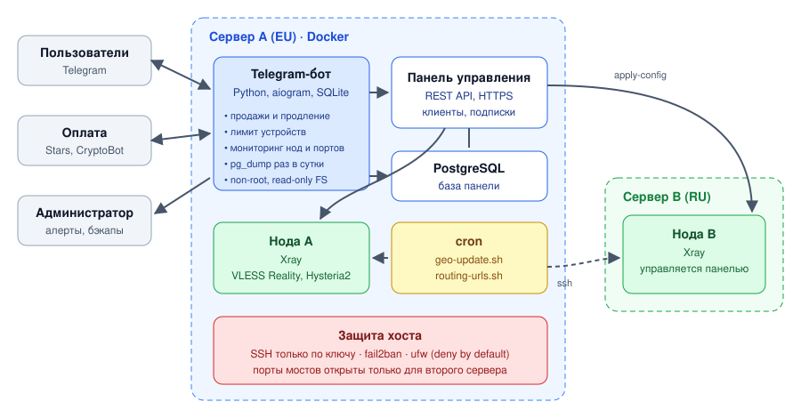

# Subscription Bot & Infrastructure

[](https://github.com/RealPycuk/subscription-bot/actions/workflows/ci.yml)


Telegram-бот для продажи и управления подписками сервиса на базе панели SharX (форк 3x-ui, ядро Xray) и инфраструктура вокруг него: два Linux-сервера в разных странах, мониторинг, бэкапы, автоматическое обслуживание по расписанию и защита хостов.

Проект работает в продакшене: бот, панель и ноды обслуживают реальных пользователей.

## Архитектура



- **Сервер A** — панель управления, её PostgreSQL, нода Xray и бот. Все сервисы в Docker.
- **Сервер B** — вторая нода; конфигурацию получает от панели.
- Бот работает с панелью только через её REST API и не хранит учётные данные клиентов у себя.

## Возможности

**Для пользователей**
- пробный период, покупка и продление: Telegram Stars и USDT через CryptoBot, с проверкой суммы и плательщика; обработка платежей идемпотентна
- карточка подписки: срок, трафик, статус подключения, ссылка для импорта
- управление устройствами: лимит устройств, блокировка лишнего устройства, перевыпуск ключа и ссылки
- реферальная программа, интерфейс на трёх языках (ru, en, es)

**Для администратора**
- команды `/stats`, `/status`, `/user`, `/clients`, `/grant`, `/link`, `/broadcast` (с предпросмотром), `/backup`
- уведомления о новых устройствах и о клиентах без лимита устройств: лимит включается автоматически

**Эксплуатация**
- **мониторинг:** каждые 2 минуты проверяются статусы нод в панели, TCP-порты из `config/monitoring.json`, заполненность диска и срок TLS-сертификата. После двух неудачных проверок подряд приходит алерт администратору, после трёх (около 6 минут) пользователям уходит сообщение о сбое в регионе, а затем о восстановлении. Регионы (`nl`, `ru`) задаются в конфиге
- **бэкапы:** ежедневно в 05:00 МСК `pg_dump` базы панели отправляется администратору в Telegram; дамп собирается в памяти и не пишется на диск
- **обслуживание по cron:** еженедельное обновление geo-списков маршрутизации на всех нодах с проверкой файлов через `xray run -test`, атомарной заменой, перезагрузкой нод через API и проверкой портов после неё; при любой ошибке старые файлы остаются, а администратору приходит алерт

## Мониторинг

Стек в [`monitoring/`](monitoring): **Prometheus, Alertmanager, Grafana, node_exporter, blackbox_exporter**. Всё слушает только `127.0.0.1`, у каждого контейнера лимит памяти; Grafana открывается через SSH-туннель.

| Что собирается | Откуда |
|---|---|
| апдейты Telegram, время обработки, ошибки хендлеров, p95 и ошибки API панели, пользователи, подписки, оплаты, доступность регионов, время последнего бэкапа | бот: `/metrics` на `prometheus_client` ([`bot/metrics.py`](bot/metrics.py)) |
| CPU, память, диск, сеть, load, OOM | node_exporter |
| доступность TCP-портов нод, время соединения, код ответа и срок TLS-сертификата панели | blackbox_exporter |

**Алерты** ([`alerts.yml`](monitoring/prometheus/alerts.yml)) приходят в Telegram через Alertmanager. Они дополняют встроенный мониторинг бота и не дублируют его: бот сам следит за нодами, портами, диском и сертификатом, а Prometheus — за тем, чего бот увидеть не может: падение самого бота, ошибки и задержки API панели, отсутствие свежего бэкапа, нехватка памяти, OOM, прогноз заполнения диска (`predict_linear`). Когда бот лежит, производные алерты подавляются через `inhibit_rules`.

У алертов есть **юнит-тесты** ([`alerts_test.yml`](monitoring/prometheus/alerts_test.yml), `promtool test rules`): проверяется, что алерт срабатывает только после нужной задержки и с правильным текстом. Они уже поймали ошибку: в первой версии сообщение о бэкапе показывало метку времени вместо возраста бэкапа.

**Дашборд** «Сервис: обзор» подключается через provisioning: статус бота и регионов, пользователи и оплаты, возраст бэкапа, нагрузка бота и API панели, ресурсы сервера, доступность портов во времени, срок сертификата.

```bash
cd monitoring
cp .env.example .env                                         # пароль Grafana
cp alertmanager/alertmanager.example.yml alertmanager/alertmanager.yml   # chat_id
printf '%s' "$BOT_TOKEN" > alertmanager/bot_token && sudo chown 65534 alertmanager/bot_token && chmod 400 alertmanager/bot_token
cp prometheus/targets/tcp.example.yml prometheus/targets/tcp.yml          # свои адреса
cp prometheus/targets/https.example.yml prometheus/targets/https.yml
docker compose up -d
ssh -L 3000:127.0.0.1:3000 user@server                       # Grafana: http://localhost:3000
```

## Безопасность

| Где | Что сделано |
|---|---|
| Контейнер бота | запуск от UID 10001, файловая система только для чтения, `cap_drop: ALL`, `no-new-privileges`, tmpfs для `/tmp` |
| Секреты | только в `.env` с правами 600, в репозитории — `.env.example`; токены не попадают в логи |
| Бот | callback-данные валидируются, весь пользовательский ввод экранируется перед выводом в HTML, SQL только с параметрами, блокировка на пользователя против двойной выдачи |
| SSH | вход только по ключу, `MaxAuthTries 3`, fail2ban с нарастающим баном (`server/harden-ssh.sh`) |
| Сеть | ufw: всё входящее закрыто по умолчанию, служебные порты открыты только для второго сервера (`server/ufw.sh`) |

## Стек

Python 3.12, aiogram 3, aiohttp, aiosqlite · Docker, Docker Compose · PostgreSQL · Prometheus, Alertmanager, Grafana, node_exporter, blackbox_exporter · Bash, cron · Xray · ufw, fail2ban · GitHub Actions

## Запуск

```bash
git clone https://github.com/RealPycuk/subscription-bot.git && cd subscription-bot
cp .env.example .env                                      # токены бота и панели
cp config/monitoring.example.json config/monitoring.json  # ноды и порты для мониторинга
chmod 600 .env
mkdir -p data && sudo chown 10001:10001 data
docker compose up -d --build
```

Тарифы задаются в `config/tariffs.json`. Отдельные значения `.env` удобно менять скриптом `scripts/set-env.sh ИМЯ ЗНАЧЕНИЕ`.

Обслуживание по расписанию:

```bash
sudo mkdir -p /opt/geo-update /etc/geo-update
sudo cp scripts/geo-update.sh scripts/routing-urls.sh /opt/geo-update/
sudo cp scripts/geo-update.env.example /etc/geo-update/geo-update.env   # заполнить
sudo cp scripts/geo-update.cron /etc/cron.d/geo-update
```

## CI

На каждый push GitHub Actions выполняет:

1. `flake8` по коду бота и проверку JSON-конфигов;
2. `shellcheck` всех bash-скриптов;
3. `hadolint` по Dockerfile;
4. сборку образа и проверку, что контейнер запускается не от root;
5. проверку `docker-compose.yml` через `docker compose config`;
6. проверку конфигов мониторинга (`promtool`, `amtool`, blackbox), юнит-тесты алертов и валидацию дашбордов.

## Структура

```
├── bot/
│   ├── main.py              # бот: хендлеры, платежи, фоновые задачи
│   ├── metrics.py           # метрики Prometheus
│   └── texts.py             # тексты интерфейса на трёх языках
├── config/
│   ├── tariffs.json         # тарифы
│   └── monitoring.example.json
├── scripts/                 # обслуживание: geo-списки, ссылки маршрутизации, правка .env
├── monitoring/              # Prometheus, Alertmanager, Grafana, exporters, алерты и их тесты
├── server/                  # защита хоста: sshd, fail2ban, ufw
├── docs/architecture.svg
├── Dockerfile
└── docker-compose.yml
```

## Планы

- [x] метрики в Prometheus, дашборд в Grafana, алерты в Telegram
- [ ] Ansible-плейбук для настройки и защиты нового сервера с нуля
- [ ] деплой бота из GitHub Actions по тегу
